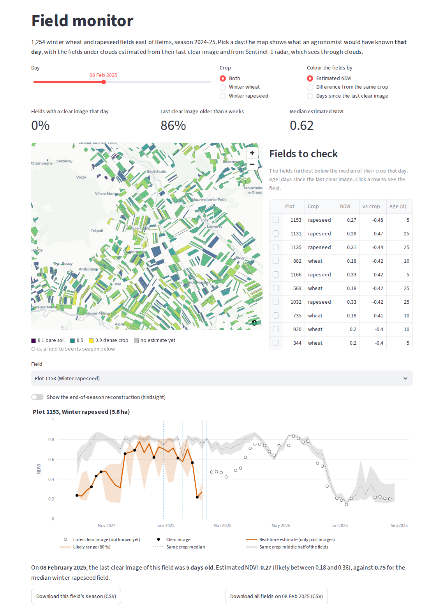

# Sentinel Agri AI

Crop monitoring from free Copernicus satellite data: what covers the ground, and how each field is
growing, even when clouds hide it for weeks.

- **Land cover:** a deep-learning model classifies Sentinel-2 tiles into 10 classes (crops, forest,
  water, built-up…), tested on new 2025 images around Reims.
- **Cloud gap-filling:** clouds blind optical satellites for weeks. Models rebuild each field's NDVI
  (its greenness) from its other images and from Sentinel-1 radar, which sees through clouds. Applied
  to 1,254 wheat and rapeseed fields east of Reims, trained on one season and tested on the next.

### Try it: **[sentinel-agri-ai.streamlit.app](https://sentinel-agri-ai.streamlit.app)**

The app calls the models through an API (FastAPI, Docker) hosted on **AWS Lambda**; its interactive
documentation is [here](https://cga6hukfpyansgulvry42cg3xi0ygxaa.lambda-url.eu-north-1.on.aws/docs).

## A free demo, not a live service

The rule of this project was to stay **100 % free**, so the app is a demo: it replays the 2024–25
season with results computed once, instead of updating every field after each satellite pass.

A live service would need a pipeline that runs every few days and a database that runs all the time.
Both are paid on AWS once its six-month Free plan ends, and the extraction job is too long for the
free Lambda. Besides, this season's register of farm plots is only published the following year.

What runs for free: the app on Streamlit Community Cloud, the models on AWS Lambda under AWS's Free
plan, and the tests on GitHub Actions. The app's page *From demo to real service* details what a real
service would add.

> **The AWS API will stop in April 2027,** when AWS's six-month Free plan ends: keeping it would mean
> upgrading to a paid account, and this project stays 100 % free. From then on, the app's field monitor
> and land-cover map keep working from their precomputed results; only the live features (the
> gap-filling trial and the classification of tiles) stop. The API can be redeployed at any time
> ([api/README.md](api/README.md)).

## The web app

| Page | What you can do |
|---|---|
| **Field monitor** | Pick any day of 2024–25 and see every field as an agronomist would have that day, estimated under clouds with a likely range, and a list of fields to check. |
| **Try the gap-filling** | Hide part of a real field's season and let the model on AWS rebuild it, scored against the hidden images. |
| **Land-cover map** | The Reims area classified in four seasons, next to ESA WorldCover, and live classification of sample or uploaded tiles. |
| **From demo to real service** | Why it is a demo, and what a real service would need. |

More in [app/README.md](app/README.md).

## Key results

- **Land cover:** 98.98 % on EuroSAT's test set, 96.6 % on new 2025 images around Reims, but 44.6 % on
  Level-2A images, the atmospherically corrected product the model never learned from.
- **Gap-filling, trained on 2023–24 and tested on 2024–25 under real cloud patterns:** 17 % lower error
  than a straight line across the gap, and in real time, 20 % lower than keeping the last clear value.
  Radar makes the difference: without it, no model reliably beats those simple answers.
- **A lesson on testing:** within one season, the models seemed to halve the error. In the next season,
  they did worse than a straight line: through the day of the year, they had learned last season's
  calendar. Removing the date fixed it.
- **Honest answers:** every estimate comes with a range calibrated to hold the truth 80 % of the time
  (75–79 % on the unseen season); frost days, when frozen plants fool the radar, are detected; known
  weak spots are measured and shown in the app.

The research behind these results is in [notebooks/README.md](notebooks/README.md).

## Inside the repository

| Folder | Content | Details |
|---|---|---|
| [notebooks/](notebooks/) | The research, as five report-style notebooks | [notebooks/README.md](notebooks/README.md) |
| [api/](api/) | The model API: FastAPI, ONNX and XGBoost, Docker | [api/README.md](api/README.md) |
| [app/](app/) | The Streamlit web app and its precomputed data | [app/README.md](app/README.md) |
| [src/sentinel_agri/](src/sentinel_agri/) | Shared code: data, models, satellite time series, gap-filling | |
| [scripts/](scripts/) | Data download, model training and export, app data | |
| [tests/](tests/), [.github/workflows/](.github/workflows/) | Tests and CI: lint, tests, Docker build on each push | |

**Data:** ESA Copernicus Sentinel-1 and Sentinel-2, via Microsoft Planetary Computer and the Copernicus
Data Space; EuroSAT; the French register of farm plots (RPG, IGN); ESA WorldCover. Code under the MIT
license.
