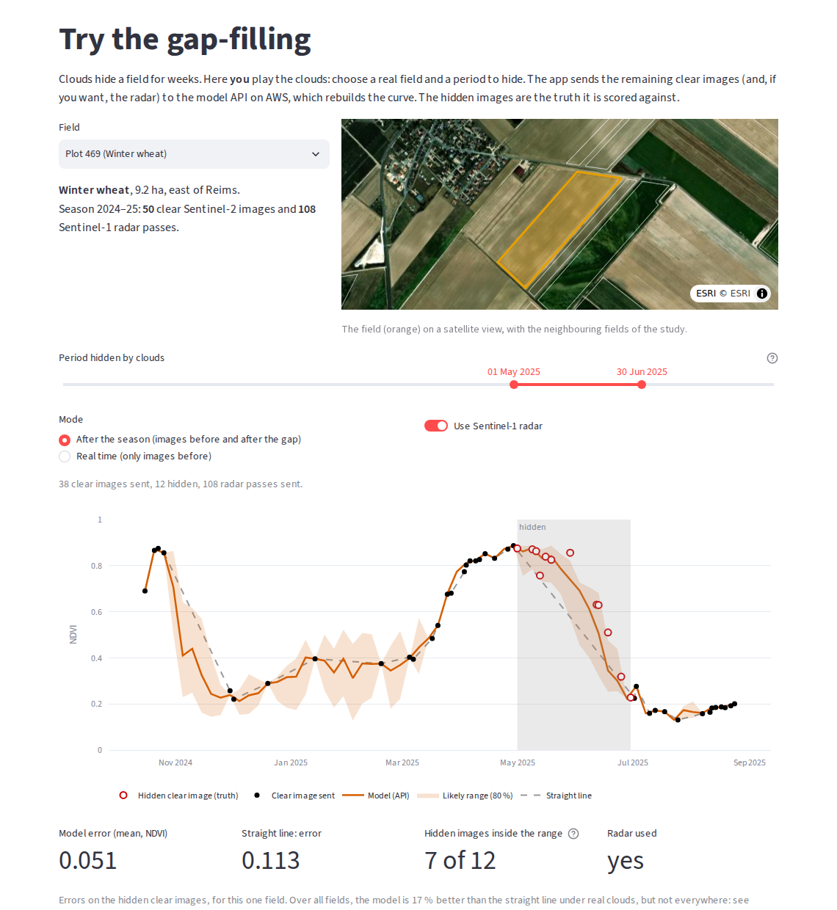

# The web app

**[sentinel-agri-ai.streamlit.app](https://sentinel-agri-ai.streamlit.app)**: a Streamlit app that lets
anyone use the models without writing code.

```
Browser  →  Streamlit app (Streamlit Community Cloud)  →  model API (AWS Lambda)
            reads precomputed results in app/data/        live predictions
```

The app holds no model. The map pages read results that a batch job computed with the same models the
API serves, as a monitoring service would after each satellite pass. The live pages call the API.

## The pages

**Field monitor.** The 1,254 wheat and rapeseed fields of 2024–25 on a map. Pick a day: each field shows
what was known that day, using only the images available up to then. Under clouds, the real-time model
estimates NDVI from the last clear image and from Sentinel-1 radar, with a likely range. The list of
**fields to check** ranks the fields furthest behind their crop; on 8 February 2025, after three weeks of
clouds, 9 of the 10 fields it flagged turned out to be really behind when a clear image came ten days
later. On **frost days**, when frozen plants fool the radar of every field at once, estimates ignore the
radar and the ranking is paused.


**Try the gap-filling.** Choose a real field, shown on a satellite view, and hide a period of its
season. The app sends the remaining images to the API, which rebuilds the curve; the hidden images are
the truth it is scored against. The page also shows, with the measured table, where the model helps
(April to the harvest) and where it fails (wheat greening up in late winter after a long gap).



**Land-cover map.** The Reims area, about 24 × 24 km, classified tile by tile on four Level-1C images of
2025, next to ESA WorldCover (74–87 % agreement). Below, classify a tile live: six samples the model
never saw, with their true class, chosen to show its whole range (sure and right, unsure, and
confidently wrong), or upload your own. Level-2A tiles are classified with a warning, to show how the
model fails on a product it never learned from.

**From demo to real service.** Why the app replays a past season instead of running live (everything
had to stay free), what a real service would add, and what was done so that the answers can be trusted.

## Run it locally

```bash
python -m venv .venv-app && .venv-app/bin/pip install -r app/requirements.txt
.venv-app/bin/streamlit run app/streamlit_app.py      # http://localhost:8501
```

It calls the API on AWS Lambda by default. To use a local one:
`API_URL=http://localhost:8000 streamlit run app/streamlit_app.py`.

## Rebuild its data

`app/data/` and `app/samples/` (about 7 MB) are committed, so the app works without the raw data. After
retraining a model, rebuild them from the research environment:

```bash
python scripts/train_gapfill.py --seasons 2023-24   # the deployed models never saw 2024-25
python scripts/build_app_data.py                     # fields, land-cover maps, sample tiles
python scripts/build_app_data.py --fields-only       # only the field results (about a minute)
```

The land-cover part downloads four full Level-1C scenes from the Copernicus Data Space once (about
150 MB each, cached), with the credentials in `.env`. The app's caches depend on the data files'
versions, so a push with new data is picked up without restarting the app.

## Deploy it (Streamlit Community Cloud, free)

1. Sign in at [share.streamlit.io](https://share.streamlit.io) with GitHub.
2. **Create app → Deploy a public app from GitHub**: repository `MedChahb/Sentinel-agri-ai`, branch
   `main`, main file path `app/streamlit_app.py`. Streamlit then installs `app/requirements.txt`, the
   light one next to the app, not the research `requirements.txt` at the root.
3. **Deploy.** Each push to `main` redeploys the app.

The app needs no secret: the API is public. To use another API, add `API_URL = "https://..."` in the
app's **Settings → Secrets**. After some hours without visitors, Streamlit Cloud puts the app to sleep;
the next visitor wakes it in about a minute. The app also wakes the Lambda API as soon as someone opens
it, so the first live prediction is usually ready when needed.
