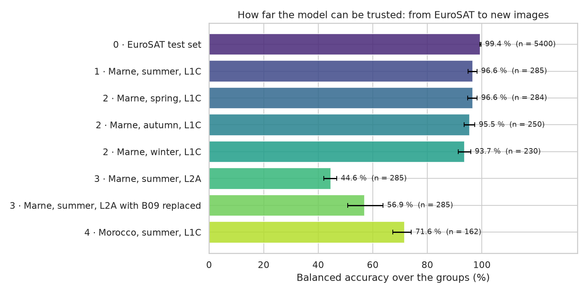
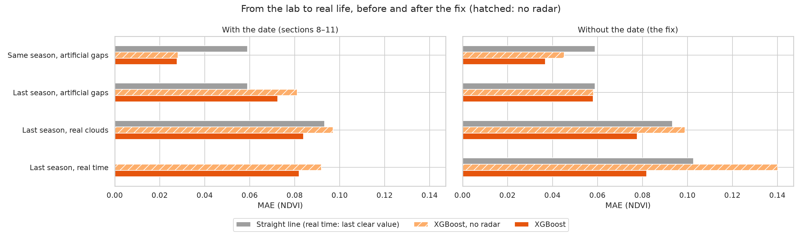

# The research: five notebooks

Each notebook reads as a report: the question, what was tried, what failed, and what the figures show.

## Part 1: land-cover classification (EuroSAT)

| Notebook | Question | Answer |
|---|---|---|
| [01 · Exploration](01_eurosat_exploration.ipynb) | What separates the 10 classes? | Average colour separates water, forest and pasture; six classes overlap and differ mostly outside RGB. |
| [02 · Models](02_eurosat_models.ipynb) | Which model, and why does it win? | A ResNet-18 pretrained on Sentinel-2 reaches **98.98 %**. The spatial pattern brings most of the gain; extra bands and pretraining add 0.7 and 0.5 points (paired tests). |
| [03 · Real world](03_eurosat_real_world.ipynb) | Does it work on new images? | Yes on new Level-1C dates (93.7–96.6 %), **no on Level-2A** (44.6 %). In Morocco, 71.6 %, mostly a label-definition effect (95.4 % without the forest group). |

| Model (EuroSAT test set) | Accuracy | 95 % interval |
|---|---|---|
| ResNet-18, Sentinel-2 pretrained, 13 bands | **98.98 %** | 98.7–99.2 |
| Small CNN, 13 bands | 98.48 % | 98.1–98.8 |
| Small CNN, RGB | 97.76 % | 97.4–98.2 |
| ResNet-18, ImageNet pretrained, RGB | 97.61 % | 97.2–98.0 |
| Random Forest + texture features | 90.07 % | 89.3–90.9 |
| Random Forest, tile averages | 83.69 % | 82.8–84.7 |



**Main limit:** the model learned from Level-1C data and fails on Level-2A, the most common Sentinel-2
product. The API therefore refuses Level-2A by default (it flagged all 1,697 Level-2A patches tested and
none of the 4,697 Level-1C ones), and classifies them only on explicit request, with a warning.

## Part 2: NDVI gap-filling with Sentinel-1 radar

| Notebook | Question | Answer |
|---|---|---|
| [04 · Data](04_ndvi_data.ipynb) | How large are the cloud gaps, does radar follow NDVI, does the crop calendar change between years? | Winter gaps last 3 to 4 weeks; 2023–24 also had a cloudy spring. Radar follows NDVI through VH for rapeseed and VH/VV for wheat. Wheat greened up a month earlier in 2023–24. |
| [05 · Gap-filling](05_ndvi_gapfilling.ipynb) | Can a model trained on last season fill this season's gaps, and what does radar add? | Within one season, learned models halve the straight line's error. Trained on last season, they do *worse* than the line: through the day of the year, they had learned last season's calendar. Without the date, XGBoost with radar is 17 % better than the line under real clouds, and 20 % better than the last clear value in real time. |



**Found later, while building the web app** (see [app/README.md](../app/README.md)):

- The gap-filling is best from April to the harvest (up to 61 % better than a straight line), and
  weak for wheat greening up in late winter after a long gap, where it still overshoots by about 0.13.
- On frost days, the radar of every field drops at once and the models saw healthy crops vanish. These
  days are now detected across all fields, and real-time estimates ignore the radar on them.
- Uncertainty ranges from quantile models held the truth only 62–72 % of the time in the new season;
  conformal calibration on held-out 2023–24 data brings it to 75–79 % for a promised 80 %.

**Main limits:** two seasons, one area and two crops. A clock that follows the weather (growing degree
days) instead of the calendar, and more training seasons, are the natural next steps.

## Reproduce

Requirements: conda, Docker, about 8 GB of disk space. An NVIDIA GPU helps for Part 1 but is not needed.

```bash
conda create -n sentinel-agri python=3.11
conda activate sentinel-agri
pip install -r requirements.txt
pip install -e . --no-deps        # makes `sentinel_agri` importable from notebooks and scripts
python -m ipykernel install --user --name sentinel-agri --display-name "Python (sentinel-agri)"
docker compose up -d mlflow       # experiment tracking -> http://localhost:5000
```

Nothing in `data/` is committed. These scripts recreate it:

| Data | Command | Size | Used in |
|---|---|---|---|
| EuroSAT, 13 bands, official splits | `python scripts/download_eurosat.py` | 3.5 GB | Part 1 |
| RPG 2025 and 2024, Grand Est (farm plots) | `python scripts/download_rpg.py` and `--year 2024` | 2.9 GB each | Part 2 |
| Sentinel-1 and Sentinel-2 series of every wheat and rapeseed plot, two seasons | `python scripts/extract_part2.py --season 2023-24` and `--season 2024-25` (about 40 minutes each, cached) | A few MB | Part 2 |

Notebook 3 also downloads Level-1C images from the [Copernicus Data Space](https://dataspace.copernicus.eu/),
which needs a free account: put `CDSE_CLIENT_ID` and `CDSE_CLIENT_SECRET` in a `.env` file at the root
(never committed). Everything else comes from [Microsoft Planetary Computer](https://planetarycomputer.microsoft.com/),
without an account.
